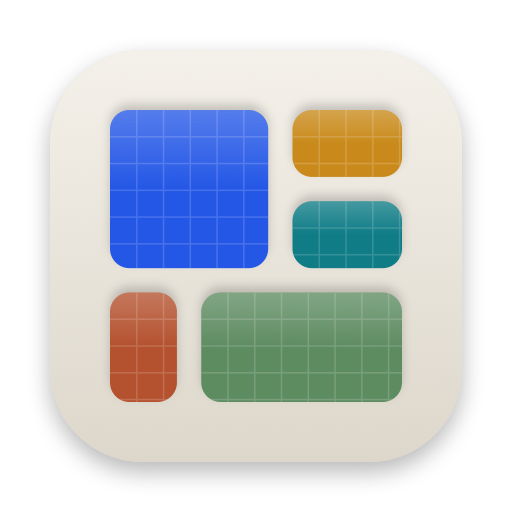

# Tessera

macOS 視窗拼貼工具：用快捷鍵、拖曳和觸控板手勢，把視窗從螢幕一邊無縫拼滿到另一邊。這個 repo 放的是簽章並經 Apple 公證的安裝檔與自動更新資訊，原始碼不公開。

[English](#english)

## 下載與安裝

1. 到 [Releases](https://github.com/chung223/tessera-releases/releases/latest) 下載最新的 `Tessera-<版本>.dmg`。
2. 打開 DMG，把 Tessera 拖進「應用程式」。
3. 打開 Tessera。第一次會出現導覽，帶你到「系統設定 → 隱私權與安全性 → 輔助使用」允許 Tessera（移動視窗一定要有）。

需要 macOS 26 以上。Tessera 住在選單列，沒有 Dock 圖示；選單列太擠看不到圖示時，再打開一次 Tessera 就會出現設定。

## 功能

- **快捷鍵貼齊**（⌃⌥ 加方向鍵、U I J K、D F G、E T⋯）：半邊、角落、三等分、最大化、置中、還原、移到另一個螢幕；重複按左右半在 1/2、1/3、2/3 之間切換。還有只移不縮、縮到 Dock、全螢幕、隱藏其他 App 等動作可以自己綁鍵。
- **無縫拼貼**：視窗之間沒有縫隙，也可以設定間距；App 只接受特定尺寸時（例如終端機），旁邊的視窗會延伸或讓位把縫補起來；拖動兩個並排視窗之間的邊，另一個也會跟著調整。
- **版面庫**：8 個內建版面，也能用格線或自由編輯器做自己的版面（區塊可以任意拖曳、縮放、重疊，或直接用目前視窗的位置建立）；每個版面可以有自己的快捷鍵。
- **拖曳版面列**：拖著視窗靠近螢幕頂端，選單列下方出現版面縮圖，放到任何一格就排好；按住 ⇧ 跨多格。也能拖到螢幕邊緣或角落貼齊；被排好的視窗拖走時會回到原本大小。
- **觸控板手勢**：兩指在標題列上滑動貼齊、捏合關閉或全螢幕、點兩下置中；兩指停一下（或按 ⌃⌥L）叫出區塊選擇器，用游標點一格。
- **工作區**：一鍵打開並排好一組 App（可以指定螢幕與版面區塊），也能在接上某組螢幕時自動套用。
- **一鍵排好所有視窗**、**新視窗自動放進指定區塊**、**依 App 例外**（某些 App 不用手勢或拖曳）。
- **螢幕改變時排回去**：拔掉或接回外接螢幕、改變解析度時，視窗回到原本的區塊。
- **給 AI agent 與自動化**：附命令列工具 `tessera`（JSON 輸出），以及捷徑 App 與 Spotlight 動作。
- **設定檔匯出入**：版面、工作區、快捷鍵與設定存成一個檔案，可以搬到另一台 Mac。

介面有繁體中文與英文，跟著系統語言切換。

## 更新

Tessera 會自動檢查新版本，有新版時會提醒你，按一下就下載安裝。也可以從選單列面板的「檢查更新…」手動檢查。

## 隱私

- 只需要「輔助使用」權限（移動視窗用），不需要螢幕錄製，也不會讀取視窗內容。
- 沒有使用統計，也沒有追蹤。唯一的網路連線是檢查更新（連到這個 GitHub repo）。

## 回報問題

到 [Issues](https://github.com/chung223/tessera-releases/issues) 開一則，附上 macOS 版本與 Tessera 版本（設定 → 關於）。

---

## English

Tessera is a macOS window tiler: snap windows edge to edge with keyboard shortcuts, a drag-to-tile layout bar and trackpad gestures. This repo hosts signed, notarized installers and update information; the source code is private.

**Install**: download the latest `Tessera-<version>.dmg` from [Releases](https://github.com/chung223/tessera-releases/releases/latest), drag Tessera into Applications, open it and allow it under System Settings → Privacy & Security → Accessibility. Requires macOS 26 or later. Tessera lives in the menu bar; if the icon is hidden in a crowded menu bar, open Tessera again to show its settings.

**Features**: shortcut snapping (halves, corners, thirds, maximize, center, restore, next display; repeating a half cycles 1/2 → 1/3 → 2/3), seamless tiling where neighbouring windows close gaps, a layout library with grid and free-form editors and per-layout shortcuts, a layout bar that appears when you drag a window to the top of the screen, screen-edge snapping, title-bar trackpad gestures and a zone picker, workspaces that open and arrange a set of apps (also automatically when a set of displays is connected), Tile All Windows, a place for each app's new windows, per-app exceptions, putting windows back when displays change, a `tessera` command line for scripts and AI agents, Shortcuts and Spotlight actions, and settings export/import. English and Traditional Chinese.

**Updates**: Tessera checks for updates automatically; you can also choose Check for Updates… in the menu bar panel.

**Privacy**: only the Accessibility permission is needed; no screen recording, no analytics or tracking. The only network connection is the update check against this repository.

**Issues**: open one in [Issues](https://github.com/chung223/tessera-releases/issues) with your macOS and Tessera versions (Settings → About).
